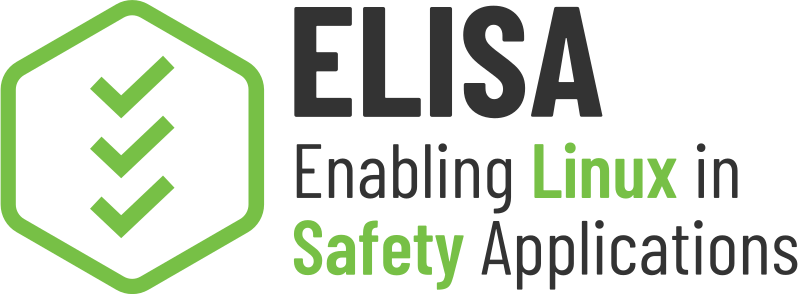

<!--
SPDX-License-Identifier: CC-BY-SA-4.0
-->

Link to contribute live to the Meeting Minutes:

- <https://hackmd.io/@AS9atTJpQgeXj_ICWAprZw/By850egu1g/edit>

Link to the Meeting's Zoom event:

- <https://zoom-lfx.platform.linuxfoundation.org/meeting/93217874199?password=0305e3a3-21c3-43a1-8369-d24c39334eec>

## ELISA Aerospace Working Group

The Aerospace Working Group shall develop use cases to inform and influence Linux architecture and related tools, work to derive technical requirements for avionics operating systems, and seek to enhance and expand avionics software lifecycle processes, practices, and tools to enable use of Linux in avionics systems that are certified to high design assurance levels. (<https://lists.elisa.tech/g/aerospace>)

# Agenda / Minutes

## Old topics

**Carry-over ACTIONs & Status Updates**

- October events debrief
- Real-Time Linux (RTL) Seminar - (Sebastian Andrzej Siewior & John Ogness, Linutronix):
  - Targeting Q1 2027 (Tuesday or Wednesday at 7:00 AM Pacific / 9:00 AM CST)
  - From the 4 previously suggested topics:
    1. Comparison scenario ("Linux vs Xenomai/RTEMS/<RTOSX>" — jitter, porting, etc.)
    2. **Embedded perspective — system tuning, state of the art for real-time tooling (e.g., analyzers)** (SELECTED)
       - General overview of tools (are there a few scenarios already captured in a dataset with metric data using these?)
         - Most likely already known: The OSADL collects long-time data about the real-time behavior of Linux: <https://www.osadl.org/OSADL-QA-Farm-Real-time.linux-real-time.0.html>
       - Metrics - cyclic/rtlat with a scenario like in-bound large IP pkts
    3. Considerations for virtualized systems with guest/partitions achieving real-time performance
       - Xen vs Dornerworks Hypervisor?
    4. **Designing for I/O Drivers (comparing multiple suggested approaches)** (SELECTED)
       - State of existing I/O drivers gaps / common designs (dos/don'ts/examples)
       - spidev? Threaded handler kernel side vs userspace priority?
  - _**ACTION:** Feedback, narrow down the topic/abstract plus structure as one combined 1-hour talk or two separate talks_
  - Martin: A follow on might be to look at commercial WCET tooling vs RTL approach (model based vs real hardware comparison)
- SpaceROS real-time capabilities
  - ACTION: [ROS 2 Real-Time Working Group](https://ros-realtime.github.io/) presentation?
  - Maybe a simple use case (RT Bench) will be ros2 environment with preempt_rt (curiosity rover demo <https://github.com/space-ros/demos/tree/main> or under ros2_control <https://github.com/ros-controls/roscon2026_control_workshop>)
- LLVM Qualification Working Group -> <https://llvm.org/docs/QualGroup.html>
  - _New:_ [OSS Japan - From Project Quality to Tool Confidence: Apply Open Frameworks to GCC for Xen](https://ossjapan2026.sched.com/event/2YNNo/from-project-quality-to-tool-confidence-applying-open-frameworks-to-gcc-for-xen-wendi-urribarri-open-source-contributor)
- Microchip - QEMU for HPSC - Brian has some internal activities working towards this yet this year. In the near term, contact <Tao.Lang@microchip.com> to request access to QEMU model for HPSC.
- seL4 on HPSC - discussion has started on a presentation in early Q1
- Hypervisor talk (Raphael) - (Email started with Min + Martin + Raphael)

## New topics

**AI meeting transcription**

- Now available to working groups
- Provides a summary of discussions
- Can be published as a later ref link in the ELISA calendar meeting
- **Suggestion:** Enable but don't publish, allows us to fill gaps in minutes; doesn't create a user attribution issue and/or misleading AI summary of conversation
- ACTION: Weber to email Min to turn it on, but not publish

**Use case call updates** (from weekly calls 10/9, 10/16, 10/23, 10/30, 11/6)

- Space processor emulation presentation (Leonidas)
  - Presented ["Faithful Emulation of Space Processors SoCs using Open Source Technologies"](https://onedrive.live.com/?id=%2Fpersonal%2F01b8647ed2301e95%2FDocuments%2FSMC%2DIT%202026%2FKosmidis%5FSpace%5FProcessors%5FQEMU%5FELISA%5FOct%5F2026%2Epdf&listurl=%2Fpersonal%2F01b8647ed2301e95%2FDocuments&ithint=file%2Cpdf&e=taUegA&migratedtospo=true&parent=%2Fpersonal%2F01b8647ed2301e95%2FDocuments%2FSMC%2DIT%202026&redeem=aHR0cHM6Ly8xZHJ2Lm1zL2IvYy8wMWI4NjQ3ZWQyMzAxZTk1L0lRRG1wemF2NkFpdlNvenZoR0FsbnpDcUFjYTlTYmlwaFN0cWx6VTE1VTlTdFZFP2U9dGFVZWdB&ga=1) ([Recording](https://zoom.us/rec/share/042njoaTE_1LK4mfYFemextrY_ApO1v0V4axot-oFvYBRExAWa-X5NCPg6QsMwdN.jAftrhvUmBguxCZt))
- Kernel minimization effort ([PR #257](https://github.com/elisa-tech/wg-aerospace/pull/257))
  - Submitted Linux kernel patches for the minimization guide and KCOV documentation to the `linux-doc` and KCOV mailing lists ([lore thread](https://lore.kernel.org/linux-doc/20261105013823.29741-1-matthew.l.weber@gmail.com/), [staging PR](https://github.com/matthew-l-weber/linux/pull/1), [example docs site](https://matthew-l-weber.github.io/linux/admin-guide/kernel-minimization.html))
  - Containerized the "Hello Init" examples for reproducible workflow examples (See [PR257 HelloInit.md](https://github.com/elisa-tech/wg-aerospace/blob/develop-kernel-minimization/docs/minimal-linux/HelloInit.md) if you'd like to test it!)
  - NEXT STEP: cFS integration as an init process on minimal Linux
  - Likely next cases are multiple processes running at init vs direct launch (do we characterize an init plus how to break a scenario of apps down)
    - e.g. using fuzzers, but similar would need to happen for a complex workload - <https://github.com/elisa-tech/wg-aerospace/blob/mlw/sort-kernel-min-work/docs/minimal-linux/MaxCoverageMultiSuite.md>
- QEMU instruction introspection & fault injection for coverage
  - Discussed automating subsystem execution tracing; shared [EPAM Xen FuSa coverage material](https://wiki.xenproject.org/wiki/FuSa_SIG/Meetings), [QEMU introspection slides](http://events17.linuxfoundation.org/sites/events/files/slides/presentation_9.pdf), and [QEMU cache-aware fault injection (`qemu-hce`)](https://github.com/radshield/qemu-hce)
  - [QEMU Linux Kernel syscall analysis using GDB stub](https://github.com/elisa-tech/wg-aerospace/blob/develop-kernel-minimization/docs/minimal-linux/hello-init/Dockerfile.gdb-stub-tracing)

**GitHub PRs** - <https://github.com/elisa-tech/wg-aerospace/pulls>

- [#267](https://github.com/elisa-tech/wg-aerospace/pull/267) **Document the automated AArch64/QEMU cabin lights demo** (DRAFT)
- [#257](https://github.com/elisa-tech/wg-aerospace/pull/257) **Starting point for kernel minimization effort** (DRAFT)
- [#237](https://github.com/elisa-tech/wg-aerospace/pull/237) Update cFS demo to use Ogma 1.15.0 (DRAFT)
- [#231](https://github.com/elisa-tech/wg-aerospace/pull/231) feat: add ARINC 615A Tool Suite
- [#177](https://github.com/elisa-tech/wg-aerospace/pull/177) Mixed crit workshop
- [#148](https://github.com/elisa-tech/wg-aerospace/pull/148) docs: add GodelEDGE onboard satellite AI inference product profile
- [#68](https://github.com/elisa-tech/wg-aerospace/pull/68) Listen for messages to monitors coming from RAW sockets (DRAFT)

**Parking lot**

- Radiation testing - <https://github.com/elisa-tech/wg-aerospace/issues/151>
- Clean up landing page structure - <https://github.com/elisa-tech/wg-aerospace/issues/159>
- Further NASA flight support - <https://github.com/elisa-tech/wg-aerospace/issues/158>
- Python and Makefile structure - <https://github.com/elisa-tech/wg-aerospace/issues/157>
- [Mixed criticality discussions](https://terminplaner6.dfn.de/en/p/a56b64ee888e0c0f528fc4aaa86ba5e7-1835668)
- NASA Datacenter hosting for OSS (RTEMS & Space Grade Linux)

## Tasks until next meeting

---

# Roll Call

## Attended this meeting

- Matt Weber - Boeing
- Martin Halle - Hamburg University of Technology
- Michael Monaghan - NASA Goddard
- Brennan Hay - NASA Goddard
- Brian Vandegriend - Microchip
- Charles Perry - Microchip
- Hiroki Hihara
- Ivan Perez - KBR @ NASA Ames Research Center
- Juan Solano
- Martin Herren
- Matthias Schmitz
- Nick Zajerko-McKee - Vorago Technologies
- Rob Woolley - Wind River
- Shefali Sharma
- Yassine Cherni - GoMyRobot

## Attended recently in the past

[List](https://github.com/elisa-tech/wg-aerospace/blob/main/meeting-minutes/ELISA-AeroWG-Meeting-DATE_template.md#attended-recently-in-the-past)

---

# Announcements

- [Events](https://github.com/elisa-tech/wg-aerospace/blob/main/docs/events.md)

- [Resources](https://github.com/elisa-tech/wg-aerospace/blob/main/docs/resources.md)

- [Action Items](https://github.com/elisa-tech/wg-aerospace/discussions)

## Code of Conduct and Legal Notices

- ELISA Project meetings involve participation by industry competitors, and it is the intention of the Linux Foundation to conduct all of its activities in accordance with applicable antitrust and competition laws. It is therefore extremely important that attendees adhere to meeting agendas, and be aware of, and not participate in, any activities that are prohibited under applicable US state, federal, or foreign antitrust and competition laws.
  - [Linux Foundation Antitrust Policy](http://www.linuxfoundation.org/antitrust-policy)
- Email communication will be treated as documentation and be received and made available by the Project under the [Creative Commons Attribution 4.0 International License](http://creativecommons.org/licenses/by/4.0). Please refer to the ELISA Technical Charter section 7 subsection iv. for details.
- The discussions in these meetings are exploratory. The opinions expressed by participants are not necessarily the policy of the companies.
- No recordings of working group meetings are permitted. Special provisions may be arranged for recording in advance with explicit consent of the participants.
- The kernel and LF Code of Conduct applies to all communication with this project
  - [Linux Foundation Code of Conduct](https://www.linuxfoundation.org/code-of-conduct/)
  - Linux [Contributor Covenant Code of Conduct](https://git.kernel.org/pub/scm/linux/kernel/git/torvalds/linux.git/tree/Documentation/process/code-of-conduct.rst)
  - Linux Kernel Contributor Covenant [Code of Conduct Interpretation](https://git.kernel.org/pub/scm/linux/kernel/git/torvalds/linux.git/tree/Documentation/process/code-of-conduct-interpretation.rst)
